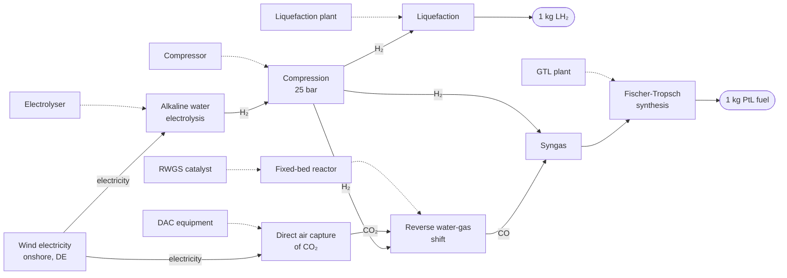
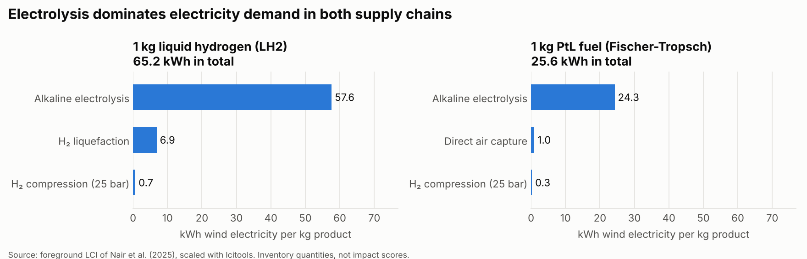
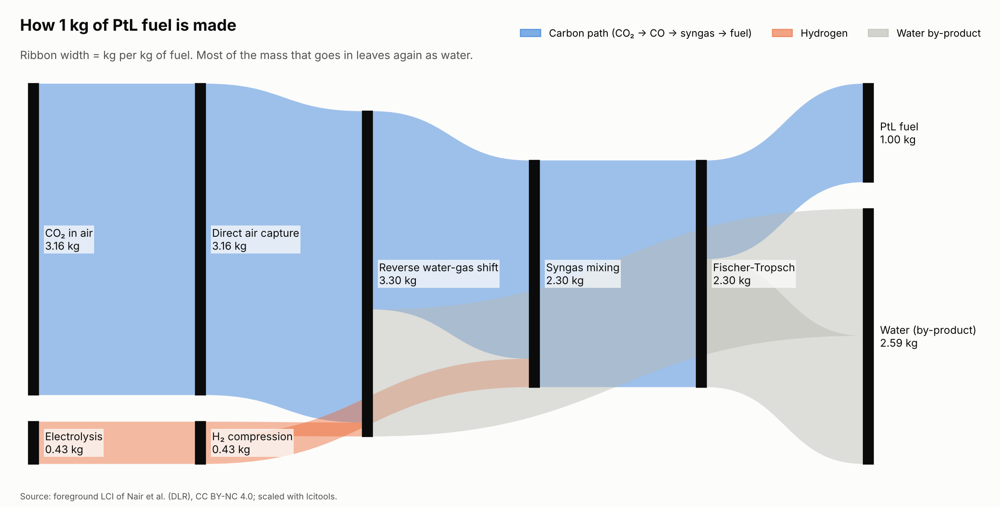
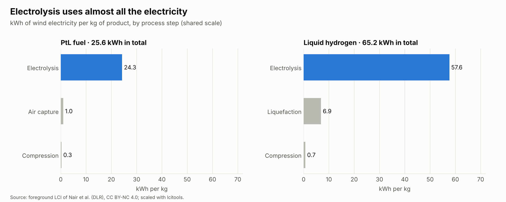
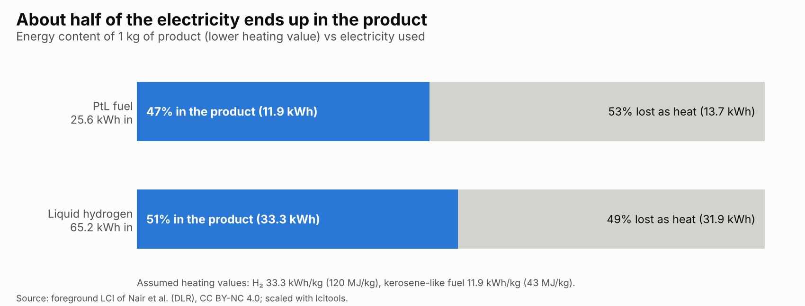
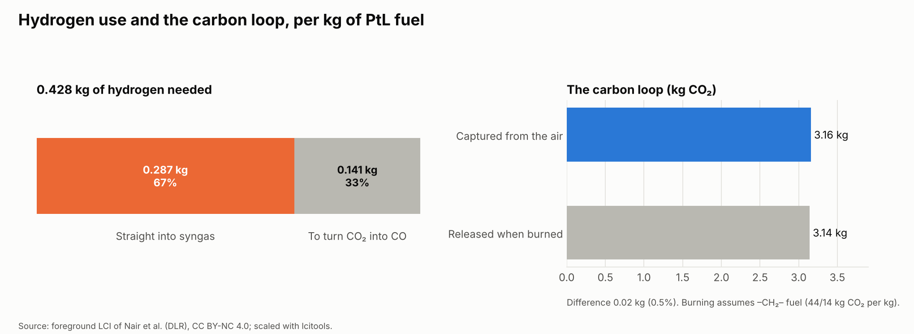
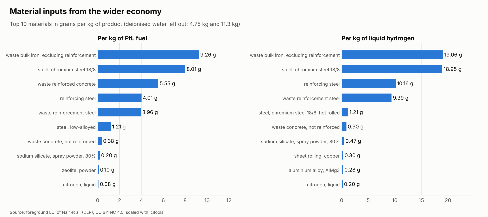
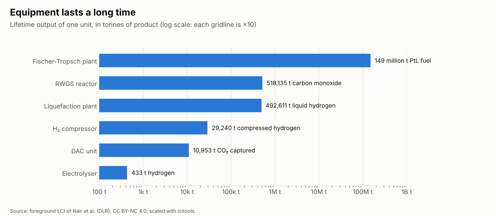
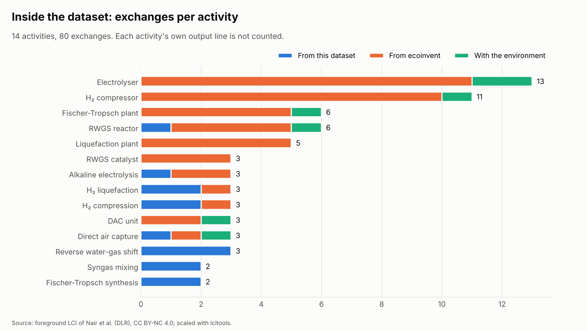

# Power-to-Liquid LCI Explorer

Python tools to **read, validate and scale** a life cycle inventory (LCI) published with the *LCIS2024* schema. The worked example is the power-to-liquid aviation fuel supply chain from:

> Nair, R. R., Chougule, K. M., Gomez Trillos, J. C., & Brand-Daniels, U.
> **A generalized schema to publish and share life cycle inventories (LCI): Exemplary case of an aviation fuel supply chain.**
> *Journal of Cleaner Production.* [ScienceDirect](https://www.sciencedirect.com/science/article/pii/S0959652625014702)

The paper proposes a common structure for publishing LCIs: a dataset, a properties file, a metadata sheet and a network graph. This repository shows what that structure makes possible. It loads the published files without the original software, checks them for internal consistency, and computes the foreground inventory per functional unit.

> This is an independent project and is not affiliated with the authors or with DLR. The dataset in [`data/original/`](data/original/) belongs to the authors and is licensed **CC BY-NC 4.0**.

## Interactive findings page

**[Open the interactive findings page](https://malleshkomal.github.io/ptl-lci-explorer/)**: all charts with hover details, a product switch, and a searchable table of all 80 exchanges. It's hosted free with GitHub Pages from [`docs/index.html`](docs/index.html), which is one self-contained file. You can also download it and open it in any browser.

## The supply chain



Dashed arrows show infrastructure (construction) activities. The inventory has 14 foreground activities and 80 exchanges, with ecoinvent 3.9 cut-off as the background database.

## Quick start

```bash
python -m venv .venv && source .venv/bin/activate   # Windows: .venv\Scripts\activate
pip install -r requirements.txt
python run.py        # validate, scale to both functional units, write results/
python make_charts.py  # draw the seven findings charts
pytest               # 10 tests
```

No Brightway or ecoinvent licence is needed. The tools work on the published files directly.

## Results

Foreground inventory per functional unit, computed by `run.py`:

| Per 1 kg of product | Liquid hydrogen (LH₂) | PtL fuel (Fischer-Tropsch) |
|---|---:|---:|
| Wind electricity | 65.2 kWh | 25.6 kWh |
| of which alkaline electrolysis | 57.6 kWh | 24.3 kWh |
| Deionised water | 11.3 kg | 4.75 kg |
| CO₂ captured from air | – | 3.16 kg |



These are **inventory quantities, not impact scores**. Turning them into kg CO₂e would need the ecoinvent background database, which is licensed separately.

Two checks against basic chemistry pass. Both are covered by the tests:
- RWGS uses 1.57 kg of CO₂ per kg of CO, which matches the molar mass ratio 44/28.
- About 3.16 kg of CO₂ is captured per kg of fuel. This is close to the CO₂ released when 1 kg of kerosene is burned, so the carbon is roughly a closed loop.

## Findings in charts

Run `python make_charts.py` to redraw these in `results/charts/`.

**1. How 1 kg of fuel is made.** 3.16 kg of CO₂ and 0.43 kg of hydrogen become 1 kg of fuel. Most of the remaining mass, 2.59 kg, leaves as water, as the chemistry predicts.



**2. Electrolysis uses almost all the electricity**: 95% for PtL fuel and 88% for liquid hydrogen.



**3. About half of the electricity ends up as energy in the product**: 47% for PtL fuel and 51% for liquid hydrogen. These figures use standard heating values, which are not part of the dataset.



**4. The carbon loop closes.** The CO₂ captured from the air is within 0.5% of the CO₂ the fuel releases when it burns.



**5. Materials are measured in grams.** Steel for plant and equipment makes up most of them.



**6. Equipment is shared across very large outputs.** Over its lifetime, one electrolyser makes 433 t of hydrogen. One Fischer-Tropsch plant makes about 149 million t of fuel.



**7. Most inventory lines describe equipment.** The process steps themselves have only 2–3 exchanges each.



The tables behind the interactive findings dashboard are in `results/dashboard_data/` as JSON.

## Validation findings

`lcitools.validate` runs six checks. On this dataset it finds no structural errors: all counts match the properties file, and every activity has one consistent production exchange. It does find two issues that are worth reporting to anyone reusing the data:

| Check | Finding |
|---|---|
| `links` | In *Alkaline electrolyser construction*, 11 background inputs (e.g. `market for corrugated board box`) are labelled with the foreground database `power-to-liquid` instead of `ecoinvent_cutoff39`. A strict importer would fail to link them. |
| `encoding` | In 8 activity comments in the CSV, an author name is mis-encoded (`René` instead of `René`). This is a UTF-8/Latin-1 mix-up. |

## How it works

| Module | What it does |
|---|---|
| `reader.py` | Parses the Brightway CSV export, where each activity block can have a different exchange header. Also reads the properties file and the LCIS2024 metadata sheet. |
| `model.py` | Builds the square foreground technosphere matrix **A** and solves **A·s = f** for the activities upstream of the demand. It then sums the background and biosphere exchanges weighted by **s**. |
| `validate.py` | Checks counts against the properties file, production exchanges, dangling foreground links, non-positive amounts, text encoding and required metadata fields. |
| `plots.py` | Draws the electricity chart. |

All of these are generic. To check another LCIS2024 dataset, place its folder next to `power-to-liquid` and run `python run.py data/original/<name>`. The functional units in `run.py` are specific to this dataset, so update them for a new one.

## Project structure

```
data/original/   the authors' files, unchanged (CC BY-NC 4.0, see its README)
src/lcitools/    reader.py, model.py, validate.py, plots.py
tests/           pytest checks (counts, mass balances, linearity)
results/         generated tables, per-unit inventories and charts
  charts/        the seven findings charts (PNG)
  dashboard_data/ tables used by the interactive dashboard (JSON)
run.py           entry point: validate and scale
make_charts.py   draw the findings charts
build_site.py    build docs/index.html from site/page.html and results/dashboard_data/
docs/index.html  the interactive findings page (GitHub Pages)
```

## Licence

- **Code** (`src/`, `tests/`, `run.py`): MIT. See [LICENSE](LICENSE).
- **Data** (`data/original/`): © the authors, [CC BY-NC 4.0](https://creativecommons.org/licenses/by-nc/4.0/). Attribution is required, and commercial use is not allowed.
